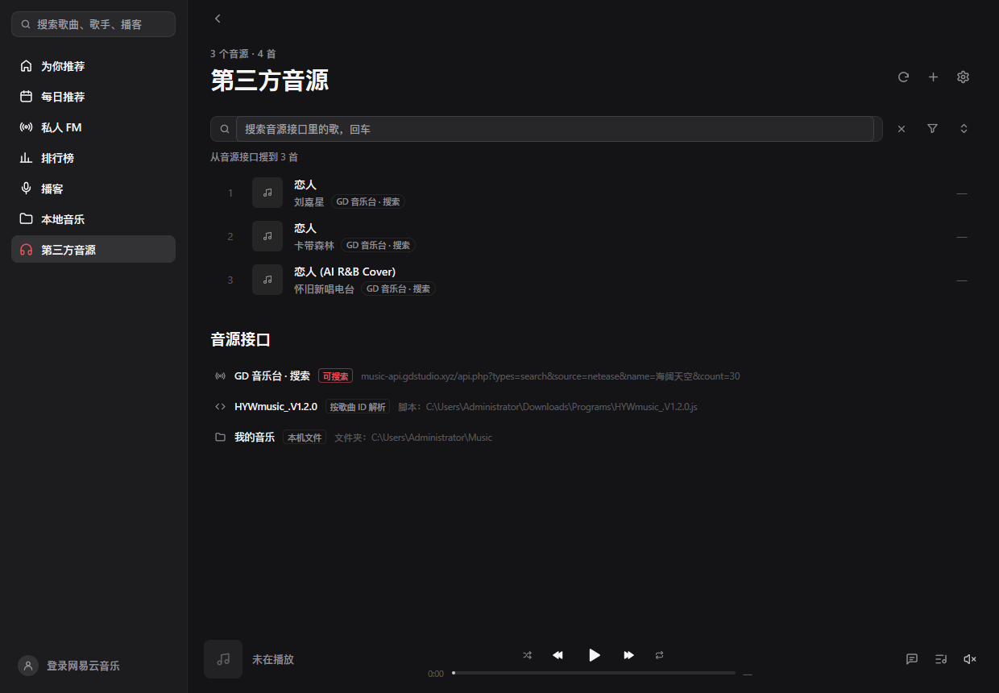
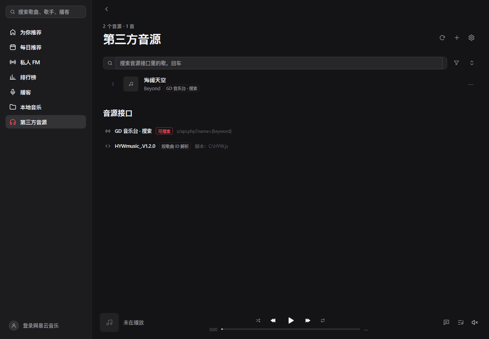
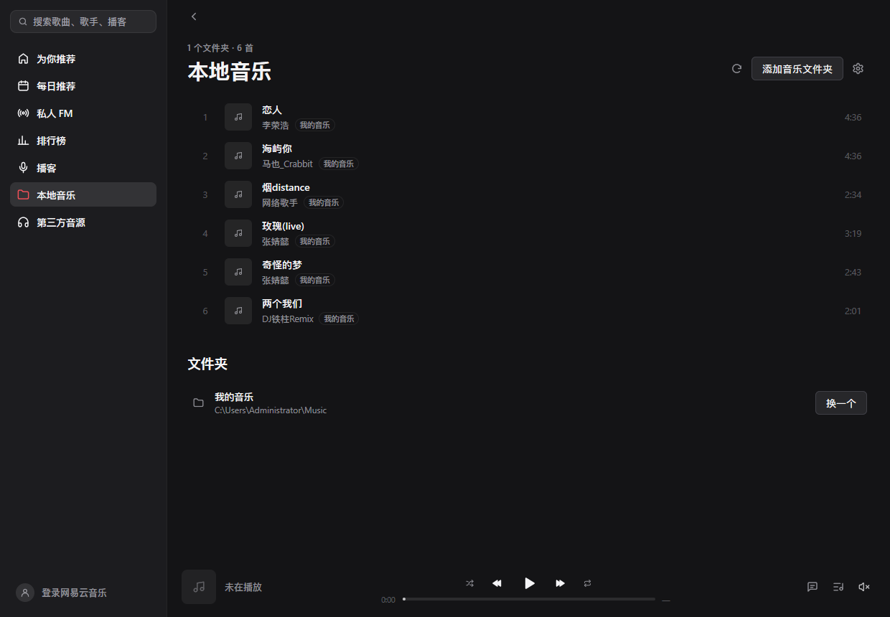
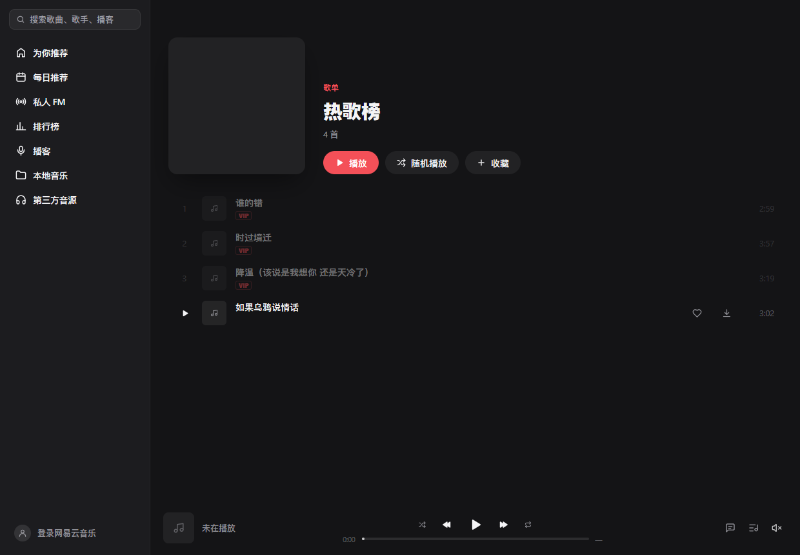
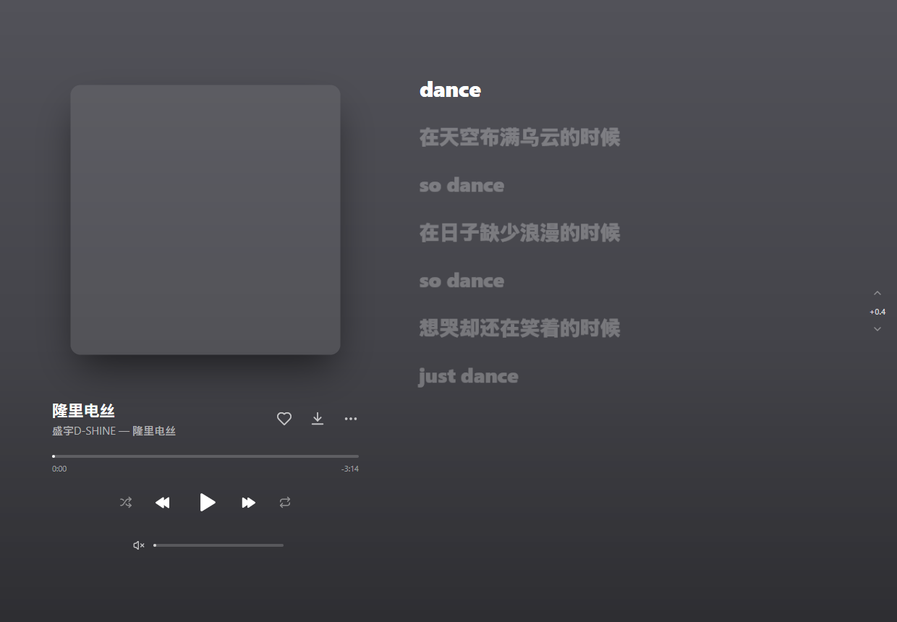
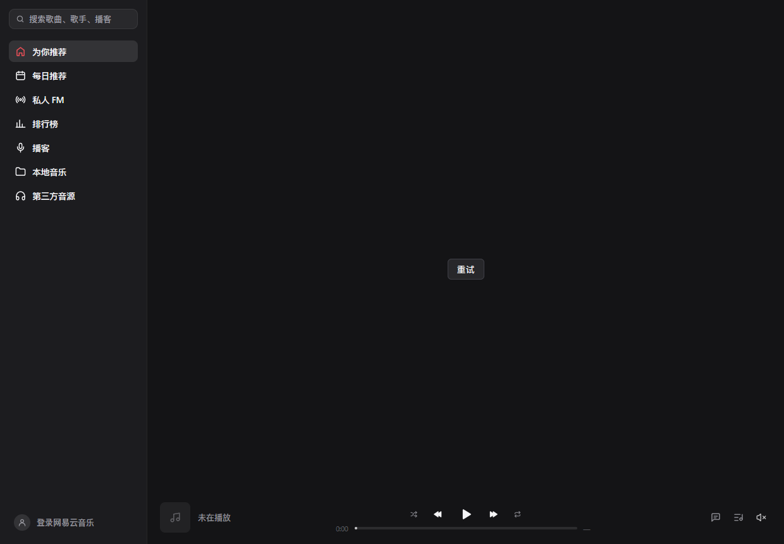

# 网易云音乐 · MyGo

用 Go 和 [MyGo](https://github.com/egoist/mygo) 写的第三方网易云音乐桌面客户端，原生界面，无 WebView。

## 功能

- 扫码登录，登录态保存在系统凭据存储中
- 每日推荐、推荐歌单、排行榜、我的歌单
- 搜索单曲、歌手、专辑、用户与播客，输入时显示搜索建议，保留搜索历史
- 歌手页的热门与最新歌曲、专辑与动态，关注歌手；专辑页与用户页
- 播客：浏览与收听节目，订阅播客；在本机把节目转写成字幕（Qwen3-ASR），像歌词一样随播放滚动
- 私人 FM（推荐 / 熟悉 / 探索）与心动模式
- 边下边播，支持标准 / 较高 / 极高 / 无损（FLAC）/ Hi-Res 音质
- 听过的歌曲缓存在本机，再次播放无需等待
- 音量均衡，暂停与继续时淡出淡入，拖动进度无杂音
- 退出后再打开，从上次的播放队列与进度继续
- 逐字歌词与翻译，正在播放页的「律动」视图与歌曲评论
- 刘海播放器：在屏幕顶部刘海处显示迷你播放器，悬停展开（在设置中开启）
- 喜欢歌曲、播放队列、随机与循环播放
- 浅色 / 深色 / 跟随系统
- 第三方音源：洛雪（LX）脚本、HTTP 接口、歌单链接、本机文件夹，网易云给不出流的歌交给它们取流；搜索可指定音源
- 本地音乐页：扫描本机音乐，支持 MP3 / FLAC / OGG / WAV，以及装有 ffmpeg 时的 WMA / M4A / AAC / OPUS / APE 等；封面歌词按歌名歌手自动补齐
- 列表与播放页的下载按钮，从最高音质逐级降级，文件连同封面歌词一起落盘
- 歌词时间偏移：现场版、翻录的歌词对不上时，用窗口右侧的箭头逐 0.1 秒微调
- 窗口置顶开关

## 截图

第三方音源页：搜索框回车即搜「网上」，右侧漏斗切换音源（洛雪脚本 / HTTP 接口 / 歌单链接 / 本机文件夹）。



音源选择器展开：逐个勾选参与搜索的音源。



本机音乐页：扫描后按格式打标记，能播的直接播，缺封面歌词的按「歌名 + 歌手」自动补齐。



列表每行悬停出现下载按钮，点一下就从最高音质往下试，文件连同封面、歌词一起落盘。



歌词对不上时，窗口右侧竖排箭头逐 0.1 秒微调（现场版、翻录版常用）。



顶栏右上角的置顶开关，实心表示已置顶，再点一下取消。



更多说明与逐项细节见 [docs/third-party-sources/features.md](docs/third-party-sources/features.md)。

## 构建

需要 Go 1.27+。

```bash
go tool mygo dev     # 开发模式运行
go tool mygo build   # 打包到 build/
go test ./...        # 运行测试
```

## 致谢

- [MyGo](https://github.com/egoist/mygo)：原生 UI 与应用框架
- [NeteaseCloudMusicApi](https://github.com/Binaryify/NeteaseCloudMusicApi)：eapi 加密与登录流程的参考
- [folia-major](https://github.com/chthollyphile/folia-major)：歌词动画效果的参考
- [sherpa-onnx](https://github.com/k2-fsa/sherpa-onnx)、[Qwen3-ASR](https://github.com/QwenLM/Qwen3-ASR) 与 [Silero VAD](https://github.com/snakers4/silero-vad)：本机语音识别
- [goja](https://github.com/dop251/goja)：洛雪音源脚本的 JS 运行时
- [oggvorbis](https://github.com/jfreymuth/oggvorbis)：Ogg Vorbis 解码
- [FFmpeg](https://ffmpeg.org)：WMA / M4A 等格式的解码，由本机已装的 ffmpeg 提供

## 贡献者

- [@qq1131909103](https://github.com/qq1131909103)：第三方音源、本地音乐、下载、歌词偏移、窗口置顶
- **DeepSeek**：参与上述功能的实现与测试

本项目与网易云音乐官方无关，音乐版权归各权利人所有。

## 许可证

[AGPL-3.0](LICENSE)
