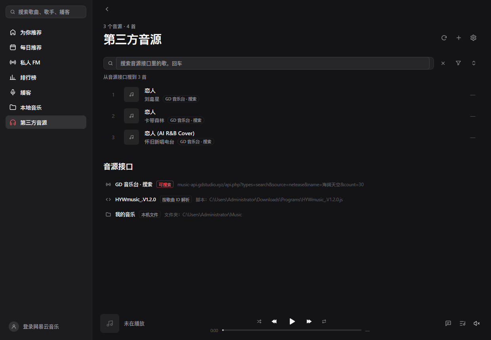
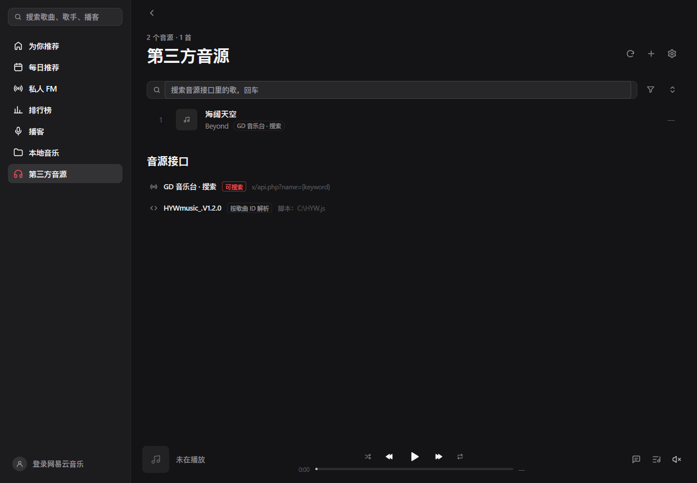
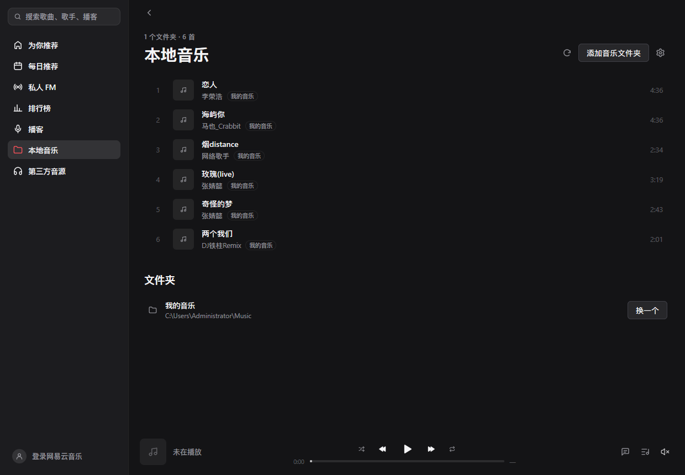
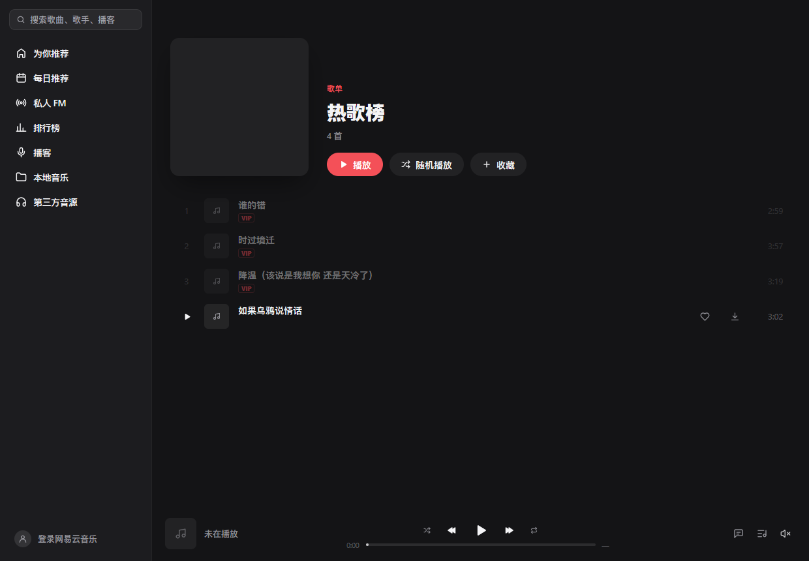
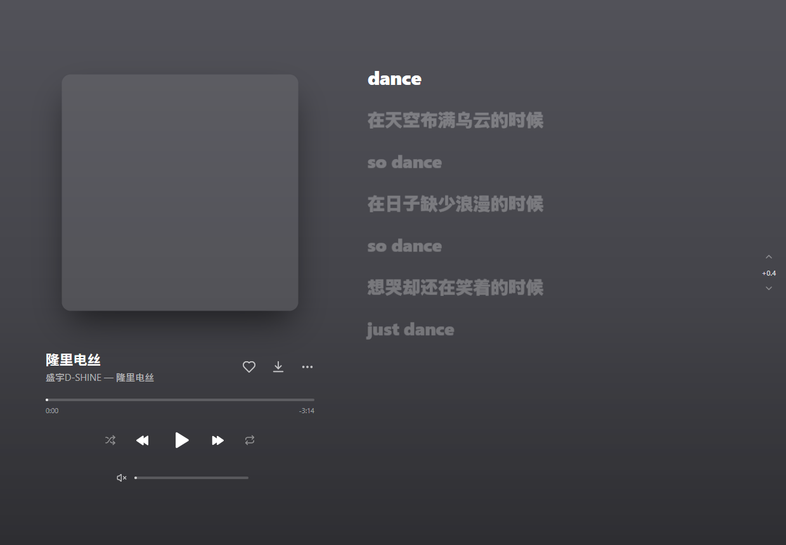
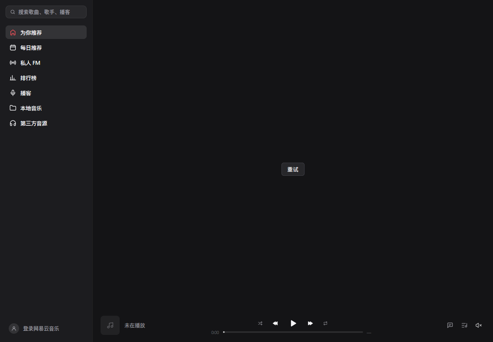

# MyGo 云音乐 · 第三方音源改造 · 功能说明（图文版）

> 基于上游 `egoist/mygo-cloudmusic` 的 `2b6673e`，81 个文件、+11353/−62。
> 所有截图都是应用**自己的渲染器**画出来的（无头环境，不依赖网络）。

---

## 一句话概括

网易云照旧用（搜歌、歌单、评论、每日推荐），**只有它给不出音频流的那几首**交给第三方音源；另外把「本机上的音乐」做成一个正经页面，能播 6 种格式，缺的封面歌词能自动补齐。

---

## 一、第三方音源：搜索 + 音源选择



页面上三块：

1. **搜索框** —— 回车搜「网上」。不是过滤本机列表，是真的去问接口。
2. **漏斗按钮（音源选择器）** —— 决定这次搜哪个源。
3. **音源接口区** —— 每条源的类型和地址，一眼看清谁在干活。

### 音源选择器



```
✓ 全部音源
  GD 音乐台 · 搜索
──────────────
  HYWmusic_.V1.2.0（脚本不能搜索）
```

**为什么洛雪脚本不能搜索？** 这不是漏配，是洛雪（LX）脚本协议本身只支持 `musicUrl`——拿一首歌的网易云 ID 去换播放地址，没有按关键词搜的能力。所以菜单里把它列出来并标注原因，而不是让它悄悄消失。

### 地址不用写 `{keyword}` 也能搜

从 GD 网站直接复制来的地址是 `...&name=海阔天空&count=30...`，歌名写死在地址里。以前这种地址被判成「不可搜索」，搜索框形同虚设。

现在：地址里带 `name` / `keywords` / `q` / `wd` / `word` / `search` 等搜索参数就算可搜，搜索时把那个参数的值换成关键词，其余参数原样保留。

```
...&name=海阔天空&count=30&pages=1
        ↓ 搜「晴天」
...&count=30&name=%E6%99%B4%E5%A4%A9&pages=1&source=netease&types=search
```

---

## 二、本机音乐：6 种格式，缺什么补什么



### 能播的格式

| 格式 | 解码器 |
|---|---|
| MP3 / FLAC | 应用自带（纯 Go） |
| OGG / WAV | mygo 自带（纯 Go） |
| WMA / M4A / AAC / OPUS / APE / AIFF / ALAC / WV | **ffmpeg**（机器上有就用） |

扫不到的格式（如 `.txt`、`.jpg`）不会混进列表；扫得到但解不了的会标 **「不支持播放」**、时长显示 **「—」**，点一下明确告诉你缺什么。

### 实测（真实文件整首解码）

```
卡塔海滩-张婧懿.ogg      271.3s @44100Hz peak=1.000
玫瑰(live)-张婧懿.wav    198.8s @48000Hz peak=0.933
Past Lives-Slushii.wma   153.1s @44100Hz peak=1.000
A Lannister…-柠檬.m4a    160.5s @44100Hz peak=0.695
```

### 封面和歌词自动补齐

本机文件没有内嵌封面、旁边也没有 `.jpg` / `.lrc` 时：

1. 拿**歌名 + 歌手**去网易云搜；
2. 只认同名同歌手的那一首（同名翻唱不会被误取，搜不到就放弃，绝不硬塞别人的封面）；
3. 歌名带版本后缀（`爱你（美好爱情）`）时，先按全名搜，再**去掉括号部分**搜一次；
4. 取到的封面写进缓存、地址回填给曲目，歌词直接给播放器；
5. 「补齐封面和歌词」按钮会**写到文件旁边**（`.jpg` / `.lrc`），下次直接读盘。

实测：`李荣浩 - 恋人.flac` → 封面 39,833 字节、歌词 2,088 字。

---

## 三、下载：列表里一点就下



每行悬停时出现 **↓** 按钮，**单击直接按最高音质下载**。

> 为什么列表里不弹音质菜单？因为从列表行里弹出的菜单收不到点击——按下去落在菜单下面的列表行上，那一行被点中开始播放，下载从没启动。播放页的菜单是好的（下面没有行抢点击），音质选择就放在那里。

真机实测：热歌榜《海屿你》点一下 → 12 秒后

```
马也_Crabbit - 海屿你.flac   66,041,443 字节
马也_Crabbit - 海屿你.jpg       359,931 字节
马也_Crabbit - 海屿你.lrc         2,564 字节
```

**一次只下一首**：正在下的那首显示阶段文字（`正在找音源…`）和进度环，其余按钮保持可点（点了回一句「还有一首正在下载」）。单个下载 10 分钟超时，卡住不会锁死按钮。

---

## 四、歌词对不上？右侧有秒数微调



现场版、翻录的歌词时间是按录音棚版标的，和实际演唱对不上。窗口**右侧、歌词右边**有上下两个箭头，中间夹着当前偏移：

```
  ⌃
 +0.4
  ⌄
```

- 上箭头 = 歌词往前（早一点）
- 下箭头 = 歌词往后（晚一点）
- 每次 **±0.1 秒**，范围 ±10 秒
- 未调整时显示 `0`（很淡）；调整后显示 `+0.4` / `-0.2` 并变亮
- **只有数字，没有任何标签文字**
- 调整会存进设置，下次播同一首不用再调

---

## 五、窗口置顶：右上角一个钉子



窗口右上角（最小化左边）有个钉子图标：

- **实心红** = 已置顶
- **空心** = 未置顶
- 点一下切换

---

## 六、其他细节

- **VIP / 已下架 / 不可播 / 不支持播放** 四种标记，区分「网易云收费」「网易云撤了」「没音源替它取流」「本机格式解不了」。
- **音质 · 音源徽章**：进度条下面显示 `Hi-Res · HYW` 这种合成徽章，鼠标悬停看地址。
- **本地页秒开**：只扫文件夹（71 首 13ms），不再陪 GD 接口等 6 秒。
- **第三方页并发加载**：各源同时问，谁先答先显示，不会整页空等最慢的那个。
- **ffmpeg 不闪黑窗**：`CREATE_NO_WINDOW`。
- **没有 ffmpeg 也不崩**：那些格式明确报「要用 ffmpeg 播放，但这台机器上没找到」，不会当 MP3 播成噪音。

---

## 七、验证

```
go build ./...   → 0
go vet ./...     → 0
gofmt（167 个文件）→ 全部干净
go test ./...    → 全部通过
```

`internal/app` 里两个刘海测试（`TestNotchGreetsOnce` / `TestNotchGreetingKeptUnderPointer`）测的是 macOS 摄像头刘海，而刘海窗口只在 `darwin` 上创建，在 Windows 上不可能通过——已改为非 darwin 时 `t.Skip`。

---

## 八、已知限制

1. **洛雪脚本不能搜索**（协议限制，只能按 ID 换地址）。
2. **WMA / M4A 等依赖 ffmpeg**：没有就只列出、标「不支持播放」。
3. **网络流不能精确拖动**：接口音源和兜底音源的时长不是服务端承诺值。
4. **歌词只认同名 `.lrc`**：不支持逐字歌词（YRC）、翻译歌词。
5. **一首歌只取第一个答得上的音源**：多配几条时按顺序问，不比较音质。
6. **「最高音质」是脚本自己声明的最高一档**：脚本没声明 `flac24bit` 时「最高」就是它有的 `flac`。
